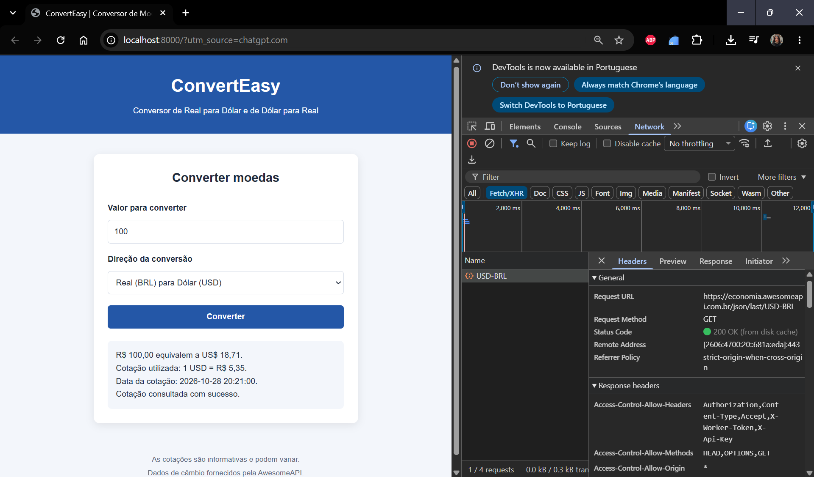

# ConvertEasy

O ConvertEasy é uma aplicação web que converte valores entre Real (BRL) e Dólar (USD), utilizando a cotação consultada na AwesomeAPI.

## Funcionalidades

- Conversão de Real para Dólar.
- Conversão de Dólar para Real.
- Consulta à cotação atual do dólar.
- Armazenamento da última cotação no navegador para uso sem conexão com a API.
- Validação dos valores informados.
- Exibição da cotação utilizada e da data informada pela API.
- Interface adaptada para computadores e celulares.

## Tecnologias utilizadas

- HTML5
- CSS3
- JavaScript
- [AwesomeAPI](https://docs.awesomeapi.com.br/api-de-moedas)
- localStorage

## Como executar

1. Clone ou baixe este repositório.
2. Abra a pasta do projeto no Visual Studio Code.
3. Execute a página com a extensão Live Server ou inicie um servidor local com:

   ```bash
   python -m http.server 8000
   ```

4. Acesse `http://localhost:8000` no navegador.
5. Informe o valor, escolha a direção da conversão e clique em **Converter**.

É necessária conexão com a internet para consultar uma cotação atualizada. Se a consulta falhar, o aplicativo tenta utilizar a última cotação salva no navegador.

## Teste da aba Rede



A captura deve mostrar a requisição GET para a AwesomeAPI, sua URL e o status HTTP retornado. Ela permite verificar a comunicação entre a aplicação e o serviço de cotação.

## Limitações

- A aplicação converte apenas entre Real e Dólar.
- Não apresenta gráficos nem histórico de variação cambial.
- A cotação salva pode ficar desatualizada quando não há conexão com a API.

## Uso de inteligência artificial

O ChatGPT foi utilizado como apoio na estruturação do código HTML, CSS e JavaScript, na integração com a AwesomeAPI e na elaboração da documentação. O código deve ser testado e compreendido pela autora antes da entrega.

## Autoria

Cleila Monteiro Dutra Galiza  
Universidade Federal do Maranhão (UFMA)  
Disciplina: Desenvolvimento de Sistemas Web
